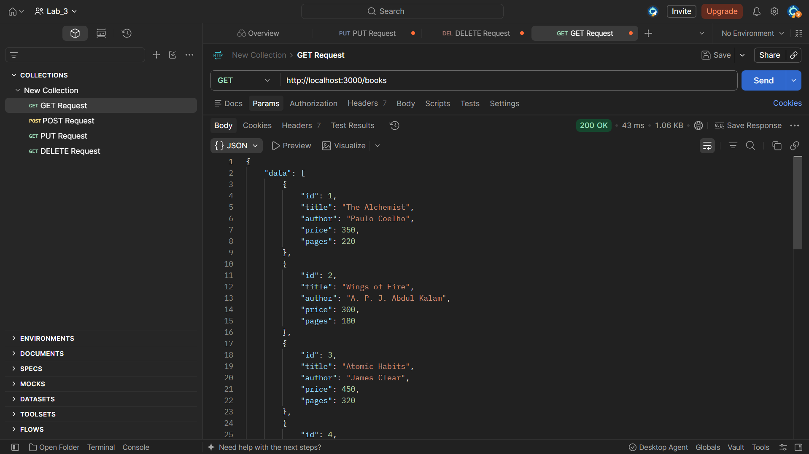
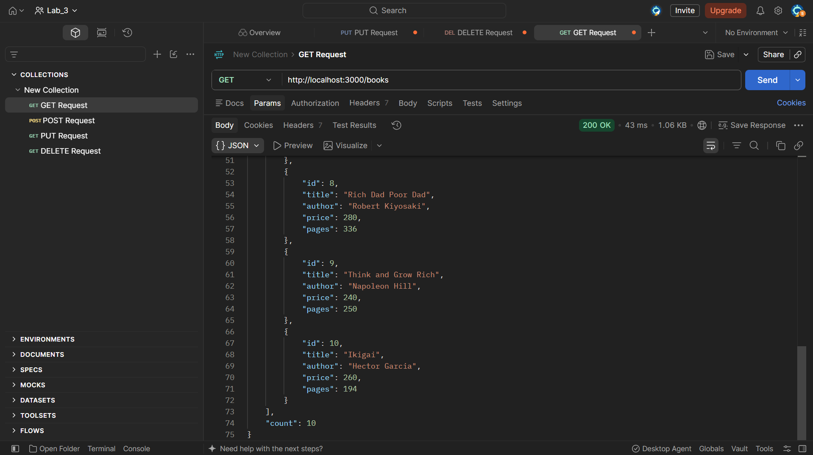
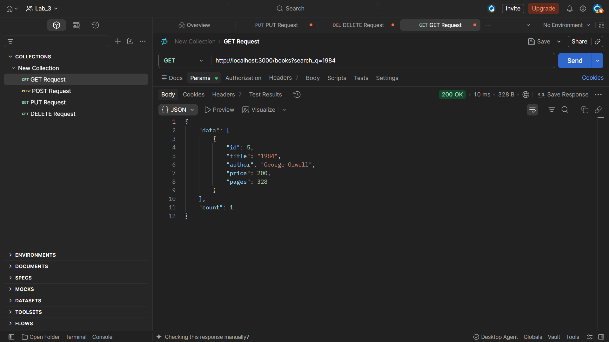
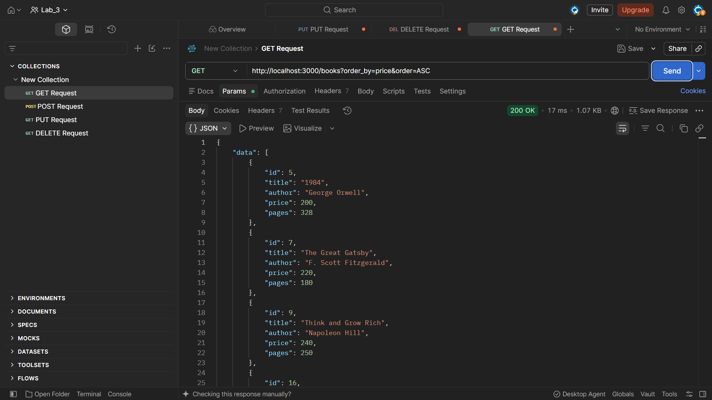
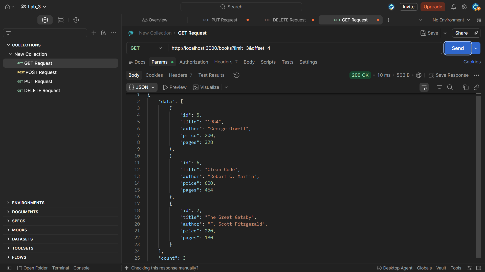
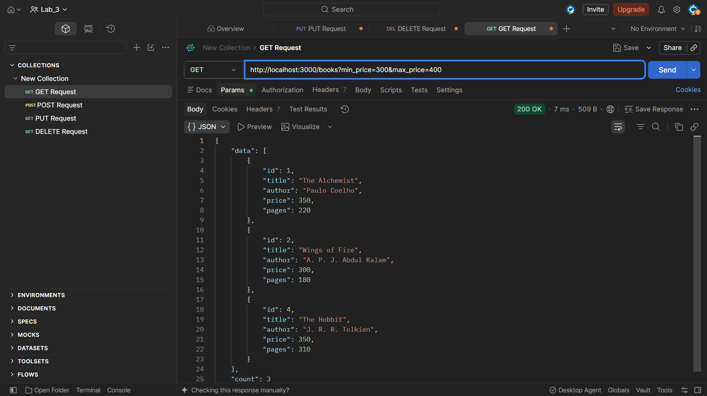
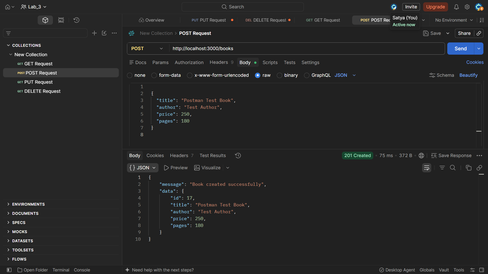
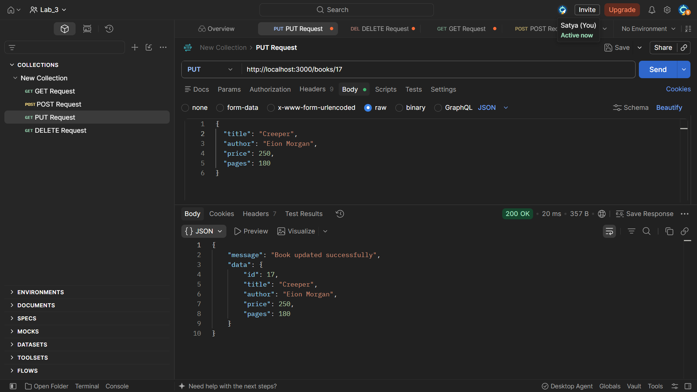
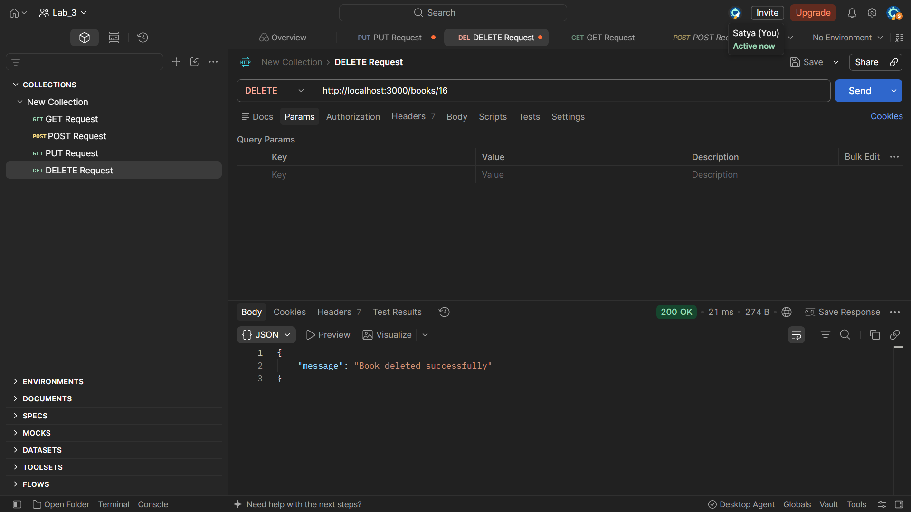

# Lab 3: REST API, Query Parameters, Validation and Debugging

## Student Details

- **Name:** Sai Preneeth
- **Registration Number:** 252U1R8019
- **Section:** CSE(QE)-2A
- **Course:** Backend Development Fundamentals (Year II Term II)


---

## Objective

To develop a clean, production-grade RESTful API using Express.js and SQLite by implementing:
1. Resource-based noun endpoints (`/books`, `/books/:bookId`) mapped to HTTP verbs.
2. Query parameter support for partial search (`search_q` with SQL `LIKE`), multi-column sorting (`order_by`, `order`), and pagination (`limit`, `offset`).
3. Range filtering (`min_price` and `max_price`).
4. Strict request body validation with `400 Bad Request` and descriptive JSON errors.
5. Standard HTTP response codes (`201` for created, `200` for success/update/delete, `404` for not found, `400` for bad input, `500` for server error).
6. Debugging common backend runtime errors (`EADDRINUSE`, bad import paths, table name typos, and missing `await`).
7. Complete API testing using Postman.

---

## Technologies Used

- **Node.js** (v24.x)
- **Express.js** (v5.x)
- **SQLite3** and **sqlite** (Async database wrapper)
- **Nodemon** (Development auto-reload)
- **Postman** (API testing & test suite generation)

---

## Project Structure

```text
lab-03/
├── app.js                           # Express application & REST API routes
├── test_api.mjs                     # Automated endpoint verification test script
├── books.postman_collection.json    # Complete Postman Collection (v2.1)
├── package.json                     # Dependencies & scripts (ES Module)
├── package-lock.json                # Locked dependency tree
├── .gitignore                       # Ignored files (node_modules, books.db, .env)
├── render.yaml                      # Render cloud deployment config
├── README.md                        # Complete lab documentation & viva answers
├── README_Lab3.md                   # Quick reference guide
└── screenshots/                     # Postman execution test evidence
    ├── get-all-books-1.png
    ├── get-all-books-2.png
    ├── search-books.png
    ├── sort-books.png
    ├── pagination.png
    ├── price-filter.png
    ├── post-book.png
    ├── put-book.png
    └── delete-book.png
```

---

## Installation & Running Locally

### 1. Install Dependencies
Open a terminal in the `lab-03` directory:
```bash
npm install
```

### 2. Start the Server
To run the server in standard mode:
```bash
npm start
```

To run in development mode with automatic reload:
```bash
npm run dev
```

The server starts at `http://localhost:3000/`.

### 3. Run Automated Tests
```bash
npm test
```

---

## Database Schema & Seeding

The application automatically creates the SQLite database file (`books.db`) if not present, and creates the `book` table:

```sql
CREATE TABLE IF NOT EXISTS book (
  id INTEGER PRIMARY KEY AUTOINCREMENT,
  title TEXT NOT NULL,
  author TEXT NOT NULL,
  price INTEGER NOT NULL,
  pages INTEGER NOT NULL
);
```

### Seed Data
When initialized for the first time, the database is populated with 10 classic books:
1. *The Alchemist* – Paulo Coelho (Price: 250, Pages: 208)
2. *Wings of Fire* – A. P. J. Abdul Kalam (Price: 300, Pages: 180)
3. *Atomic Habits* – James Clear (Price: 450, Pages: 320)
4. *The Hobbit* – J. R. R. Tolkien (Price: 350, Pages: 310)
5. *1984* – George Orwell (Price: 200, Pages: 328)
6. *Clean Code* – Robert C. Martin (Price: 600, Pages: 464)
7. *The Great Gatsby* – F. Scott Fitzgerald (Price: 220, Pages: 180)
8. *Rich Dad Poor Dad* – Robert Kiyosaki (Price: 280, Pages: 336)
9. *Think and Grow Rich* – Napoleon Hill (Price: 240, Pages: 250)
10. *Ikigai* – Hector Garcia (Price: 260, Pages: 194)

---

## REST API Endpoints Specification

Base URL: `http://localhost:3000`

| Method | Endpoint | Description | Success Code | Error Codes |
|---|---|---|---|---|
| **GET** | `/` | Health check & API documentation | `200 OK` | `500` |
| **GET** | `/books` | List books with search, sort, filter & page | `200 OK` | `400`, `500` |
| **GET** | `/books/:bookId` | Retrieve single book by ID | `200 OK` | `400`, `404`, `500` |
| **POST** | `/books` | Create a new book | `201 Created` | `400`, `500` |
| **PUT** | `/books/:bookId` | Update an existing book | `200 OK` | `400`, `404`, `500` |
| **DELETE**| `/books/:bookId` | Remove a book | `200 OK` | `400`, `404`, `500` |

---

## Query Parameters (`GET /books`)

All query parameters are optional and have sensible defaults:

| Parameter | Type | Default | Description / Allowed Values |
|---|---|---|---|
| `search_q` | string | `""` | Partial title match using SQL `LIKE %search_q%` |
| `order_by` | string | `"id"` | Column to sort by: `id`, `title`, `author`, `price`, `pages` |
| `order` | string | `"ASC"` | Sort direction: `ASC` or `DESC` |
| `limit` | integer | `10` | Page size: integer between `1` and `100` |
| `offset` | integer | `0` | Number of records to skip: non-negative integer |
| `min_price`| number | `none` | Filter books with `price >= min_price` |
| `max_price`| number | `none` | Filter books with `price <= max_price` |

### Query Examples

- Search title containing "atomic":
  ```text
  GET /books?search_q=atomic
  ```
- Sort books by price descending:
  ```text
  GET /books?order_by=price&order=DESC
  ```
- Paginate 5 items per page skipping first 5:
  ```text
  GET /books?limit=5&offset=5
  ```
- Price range filter between 200 and 400:
  ```text
  GET /books?min_price=200&max_price=400
  ```
- Combined query:
  ```text
  GET /books?search_q=the&order_by=price&order=ASC&min_price=200&max_price=400&limit=5&offset=0
  ```

---

## Validation & Error Handling

All error responses return a uniform JSON format:
```json
{
  "message": "Specific error description"
}
```

### Request Body Validation (`POST /books`, `PUT /books/:bookId`)
- `title`: Must be a non-empty string.
- `author`: Must be a non-empty string.
- `price`: Must be a non-negative finite number.
- `pages`: Must be a positive integer (> 0).

### Validation Failure Status Codes
- Missing title / author / non-numeric price: `400 Bad Request`
- `min_price` greater than `max_price`: `400 Bad Request`
- Invalid sort column or direction: `400 Bad Request`
- Malformed JSON body: `400 Bad Request`
- ID not found for GET, PUT, or DELETE: `404 Not Found`

---

## Postman Test Suite & Checklist

A ready-to-import Postman collection is provided in `books.postman_collection.json`.

### Test Cases Covered:
1. `GET /` – Health check route (`200 OK`)
2. `GET /books` – Retrieve all seeded books (`200 OK`)
3. `GET /books?search_q=atomic` – Partial title search (`200 OK`)
4. `GET /books?order_by=price&order=ASC` – Price ascending sort (`200 OK`)
5. `GET /books?order_by=price&order=DESC` – Price descending sort (`200 OK`)
6. `GET /books?limit=3&offset=0` – Pagination check (`200 OK`)
7. `GET /books?min_price=200&max_price=350` – Price range filter (`200 OK`)
8. `GET /books/:bookId` – Fetch specific ID (`200 OK`)
9. `POST /books` – Valid creation (`201 Created`)
10. `PUT /books/:bookId` – Update existing ID (`200 OK`)
11. `DELETE /books/:bookId` – Delete existing ID (`200 OK`)
12. `POST /books` – Missing title validation error (`400 Bad Request`)
13. `POST /books` – Missing author validation error (`400 Bad Request`)
14. `POST /books` – Non-numeric price validation error (`400 Bad Request`)
15. `GET /books?order_by=invalid` – Disallowed column (`400 Bad Request`)
16. `GET /books?min_price=500&max_price=200` – Inverted price bounds (`400 Bad Request`)
17. `GET /books/9999` – Non-existent record (`404 Not Found`)
18. `PUT /books/9999` – Non-existent update (`404 Not Found`)
19. `DELETE /books/9999` – Non-existent delete (`404 Not Found`)

---

## Postman Screenshots

The screenshots of the executed tests are stored in `screenshots/`:

| Test Name | Screenshot |
|---|---|
| **1. Get All Books** | <br> |
| **2. Search Books** |  |
| **3. Sort Books** |  |
| **4. Pagination** |  |
| **5. Price Filter** |  |
| **6. Add Book (POST)** |  |
| **7. Update Book (PUT)** |  |
| **8. Delete Book (DELETE)** |  |

---


